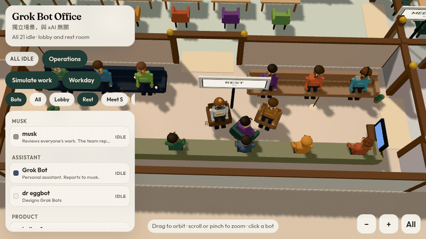
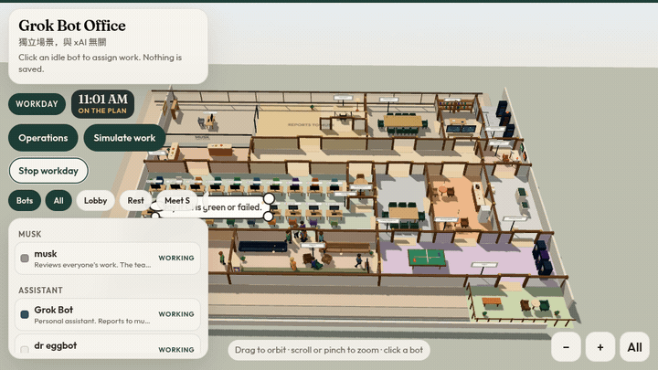
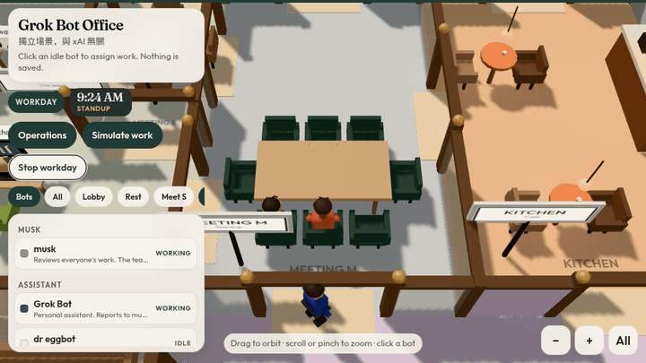
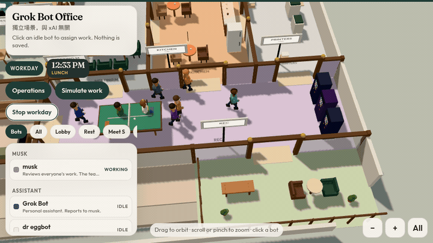
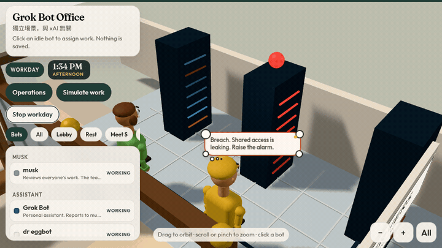
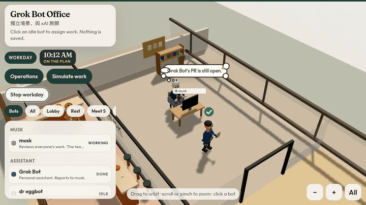
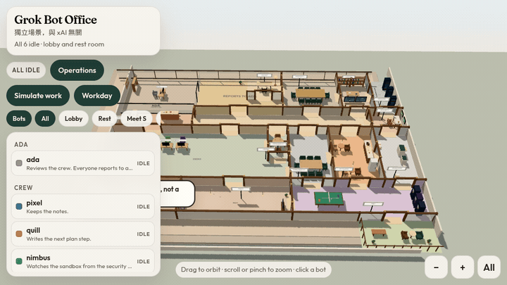

# Grok HQ

給一組機器人用的故事書 3D 辦公室。預設是這支 Grok Bot 團隊，全員向 **musk** 回報。換成你自己的名單，只要改 `public/team.json`。

這是獨立作品，**不是 xAI 的官方產品，也與 xAI 沒有從屬或合作關係**。


早上的 **Workday**（`?day=1`）。時鐘往前走，人在大廳裡走動。

## 怎麼跑

需要 Node.js 20 或更新版本。

```bash
git clone https://github.com/tonythetiger168/grok-hq.git
cd grok-hq
npm install
npm run dev
```

PowerShell 若擋住 `npm.ps1`，改用 `npm.cmd install` 和 `npm.cmd run dev`。

終端機會印出本機網址（預設 `http://127.0.0.1:4317`）。

| 網址 | 做什麼 |
| --- | --- |
| `?day=1` | 一日工作，約幾分鐘走完 9:00 AM 到 6:00 PM。可加 `?at=10:30` |
| `?simulate=1` | 短的忙碌示範。`?demo` 和 `#demo` 也行 |
| `?ops=1` | 營運控制室，讀狀態，開發伺服器可選讀 GitHub |
| `?team=example` | 預覽另一組名單（ada 的小隊），不改你的 `team.json` |

正式靜態檔：

```bash
npm run build
npm run preview
```

`dist/` 就是可以放到任何靜態主機的成品。`npm run preview` 會一併帶上開發用的狀態 API；純靜態主機沒有這個 API，狀態改走 `status.json`。

檢查名單與狀態格式：

```bash
npm run check
```

## 畫面上有什麼

- **musk** 坐在玻璃隔間的角落辦公室。地毯與玻璃上都寫著大家向 musk 回報。
- **Grok Bot** 是個人助理，桌子在 Assistant，不是主管。
- 一層樓的故事總部，樣子參考過別的 3D 辦公室，家具是自己畫的。入口是一小間大廳。會議室有三間：Meeting S 是小間，Meeting M 是玻璃站會間，Meeting L 是大桌。唯一的主管仍是 musk，地上寫著 REPORTS TO MUSK。北面原本的空辦公室改成桌子灣，多坐五個人。Kitchen 是廚房兼咖啡室。Rest 和 Rec 在同一翼：沙發、電視、乒乓球、街機、點唱機。Printers 是影印室。Library 是書架。東邊是 SERVERS 機房：機櫃、閃燈、地上有線。機房南邊是 SECURITY 值班桌，有螢幕和警示燈。下午有人先看機櫃，再到值班桌看 sandbox。若故事裡的檢查失敗，警示燈會亮，他們說漏了什麼，再趕去向 musk 回報。musk 決定封鎖、隔離、再查，或繼續看著。Rec 外面是小陽台。團隊坐同一間桌子廳。走廊岔出點心吧。
- 開源研究的十位跟大家坐在同一間桌子廳。
- 預設每個人都是 **Idle**，坐在休息區。桌子是空的，名牌還在。沒有人在做「真的工作」。
- 滑過角色會出現名字。點一下（或點名冊）會把鏡頭拉近，並跟著那位角色。
- 兩個人說話時，中間會浮出對話雲；一個人自言自語也有。想事情是另一種思考雲：雲朵形，底下有一串小圓點連回頭上。
- 點一個 **Idle** 的人，在頭頂對話雲裡打工作內容，按 Enter。對方會離開休息去做事；若寫到 PR、CI、plan 或 sandbox，之後向主管回報時會沿著這句話。




- 拖曳旋轉、滾輪或雙指縮放、右鍵平移。手機上有放大、縮小、回到全景。
- 上方的分區按鈕把鏡頭帶到該區。
- 大廳牆邊有一面「每週用量」板，只寫稍後再接，**沒有任何數字**。

## 一日工作

「Workday」按鈕，或網址 `?day=1`，用幾分鐘演完 9:00 AM 到 6:00 PM。站會走進 Meeting M 的門口。咖啡在廚房，休息和遊戲在 Rest / Rec，影印走進 Printers。一次只有一個人把文件拿給主管。這只在這個分頁裡演，不會寫入 `status.json`。





sandbox 檢查先在機櫃前開始。故事裡若失敗，保安值班桌的螢幕和燈會轉紅，再向主管報告。主管決定封鎖、隔離、再查，或繼續看著。





## 模擬工作

「Simulate work」按鈕，或網址加上 `?simulate=1`、`?demo`、`#demo`，會在**這個分頁裡**演一段忙碌的一天：有人在自己的桌子打字，有人到會議室開站會，有人站在會議室門口揮手，有人頭頂紅色驚嘆號。做完的人會拿著文件走進 musk 的辦公室交件，轉一圈，再回到休息區。

畫面頂部會出現 **SIMULATION** 徽章，還有一條橘色細線。這段動畫**不會**寫入 `status.json`，也不會對 `/api/status` 送出資料。按「Stop simulation」之後，畫面回到伺服器或靜態檔上的狀態。

## 營運

「Operations」按鈕，或網址 `?ops=1`，把辦公室當成控制室。人的位置跟 `GET /api/status`（沒有 API 就用 `status.json`）的 `idle`、`working`、`waiting`、`error`、`done` 走：做事的人在桌子或站會，卡住的人停在桌邊，做完的人一次一個去找 musk。名冊裡有倉庫的人，開發伺服器會用 GitHub 讀最近的 PR 是開著、關掉還是已合併，以及 CI 是綠的、失敗還是還在跑。讀不到 GitHub 時，只用狀態裡寫明的 `pr`、`ci`、`plan`，畫面上會標 **status**，不會假裝那是即時數字。

桌子螢幕下方有一條顏色：綠、紅、黃。點人名可以看到 PR、CI，以及來源是 GitHub 還是 status。musk 的決定、對話雲、還有你在頭頂雲朵打的工作，都用同一組詞：計畫、PR、CI、下一步。打字派工只留在這個分頁，不會 POST。Workday 和 Simulate 也不會寫狀態。

```bash
curl -s -X POST http://127.0.0.1:4317/api/status \
  -H 'content-type: application/json' \
  -d '{"name":"quant","state":"done","task":"reporting the open PR","pr":"open","ci":"green","plan":"review"}'
```

`pr` 是 `open`、`closed`、`merged`、`none`。`ci` 是 `green`、`failed`、`pending`、`none`。POST 若省略這三欄，會留下上一次的值。

## 接上真正的狀態

程式先試 `GET /api/status`，失敗再讀 `/status.json`。格式：

```json
{
  "bots": [
    { "name": "quant", "state": "working", "task": "reading the repo", "plan": "review", "pr": "open", "ci": "green" }
  ]
}
```

`state` 只能是 `idle`、`working`、`waiting`、`error`、`done`。沒寫到的人維持 `idle`。`task` 最長 140 字。`plan`、`pr`、`ci` 可省略。名字要和名冊完全一致（大小寫不拘），例如 `Grok Bot`、`dr eggbot`、`helios forge`。

`public/status.json` 預設全員 `idle`。改這個檔再重新整理，靜態站就會顯示新狀態。

`npm run dev`（以及 `npm run preview`）另外提供記憶體版 API。它啟動時讀一次 `status.json`，之後的 POST 只活在該次行程裡，重新啟動就回到檔案內容，也**不會**把模擬寫進去。

```bash
curl -s http://127.0.0.1:4317/api/status

curl -s -X POST http://127.0.0.1:4317/api/status \
  -H 'content-type: application/json' \
  -d '{"name":"quant","state":"working","task":"reading the repo"}'
```

一次更新多人：`{"bots":[...]}`。全部回到休息：`{"reset":true}`。

機器人可以在開始時 POST `working` 和一行 task，需要人時 POST `waiting`，卡住時 POST `error`，做完時 POST `done`，回到休息時 POST `idle`。瀏覽器大約每 4 秒讀一次。正式環境請自己做一個同樣格式的 `GET/POST /api/status`，或只更新 `status.json` 再部署。

## 用你自己的機器人

編輯 `public/team.json`。`leader` 是大家回報的那一位，必須是 `bots` 裡的 `id`。每位可以有自己的名字、組別、顏色、一句角色，以及選填的 `repo`（`owner/name`，給 Operations 讀 PR / CI）。這層樓最多 26 人。名牌是「名字 · 工作」。狀態 API 的 `name` 可以寫 id，也可以寫完整名牌。不寫 `cast` 時，站會、報告、sandbox 檢查會依名單自動排，不綁死某個人的名字。

改完請重新啟動 `npm run dev`，狀態 API 才會認得新名字。瀏覽器重新整理會讀到新的樓層。

```json
{
  "leader": "ada",
  "groups": [
    { "id": "lead", "label": "ada", "blurb": "Corner office" },
    { "id": "crew", "label": "Crew", "blurb": "The desk hall" }
  ],
  "bots": [
    { "id": "ada", "name": "ada", "group": "lead", "role": "Reviews the crew.", "color": "#8e949e" },
    { "id": "pixel", "name": "pixel", "group": "crew", "role": "Keeps the notes.", "color": "#3c6e9a", "repo": "you/your-repo" }
  ]
}
```

`public/team.example.json` 是 ada 的六人小隊。網址加 `?team=example` 可以先看，不必覆蓋你的檔。



任何框架都可以 POST 同一份狀態。名字要和名單一致。`state` 是 `idle`、`working`、`waiting`、`error`、`done`。`pr` 是 `open`、`closed`、`merged`、`none`。`ci` 是 `green`、`failed`、`pending`、`none`。省略 `plan`、`pr`、`ci` 會留下上一次的值。GitHub 查詢是選用的：只有 `repo` 有寫、而且這台機器的 `gh` 讀得到時，開發伺服器才會補上 PR / CI。瀏覽器不會自己打 GitHub。

```bash
curl -s -X POST http://127.0.0.1:4317/api/status \
  -H 'content-type: application/json' \
  -d '{"name":"pixel","state":"working","task":"reading the repo","plan":"review","pr":"open","ci":"green"}'
```

## 檔案

| 檔案 | 做什麼 |
| --- | --- |
| `index.html` | 頁面外殼 |
| `src/main.js` | 場景、燈光、鏡頭、點選、動畫迴圈 |
| `src/office.js` | 房間、桌子、交誼區、植物、伺服器、用量牆 |
| `src/bots.js` | 角色造型與動作 |
| `src/clouds.js` | 對話雲與思考雲 |
| `src/team.js` | 讀名單、主管，以及沒寫劇本時怎麼排一天 |
| `src/roster.js` | 把目前的名單轉給其他檔案 |
| `public/team.json` | 預設名單。換成你自己的機器人就改這裡 |
| `public/team.example.json` | ada 的範例小隊，`?team=example` |
| `src/layout.js` | 平面配置與鏡頭預設 |
| `src/status.js` | 輪詢狀態、營運、模擬、一日工作 |
| `src/status-model.js` | 狀態格式，瀏覽器與開發伺服器共用 |
| `src/ops-summary.js` | 把 PR / CI 收成辦公室用的詞 |
| `scripts/github-ops.mjs` | 開發伺服器讀 GitHub，瀏覽器不直接打 |
| `src/ui.js` | 名冊、徽章、模擬按鈕 |
| `src/style.css` | 介面樣式 |
| `src/geom.js` | 小幾何工具 |
| `src/paint.js` | 文字與貼圖 |
| `src/screens.js` | 螢幕著色 |
| `vite.config.js` | 開發伺服器與 `/api/status` 雛形 |
| `public/status.json` | 靜態狀態，預設全員 idle |
| `scripts/check.mjs` | 檢查名單與狀態合併 |

## English

A storybook 3D office for a team of bots. The sample roster is the Grok Bot team, and everyone reports to **musk**. To use your own bots, edit `public/team.json`.

It is not an official xAI product and is not affiliated with xAI.


## Run it

Node.js 20 or newer.

```bash
git clone https://github.com/tonythetiger168/grok-hq.git
cd grok-hq
npm install
npm run dev
```

If PowerShell blocks `npm.ps1`, run `npm.cmd install` and `npm.cmd run dev` instead.

The dev server prints a local URL, `http://127.0.0.1:4317` by default.

| URL | What it does |
| --- | --- |
| `?day=1` | Workday, 9:00 AM–6:00 PM in a few minutes. Optional `?at=10:30` |
| `?simulate=1` | Short busy demo. `?demo` and `#demo` do the same |
| `?ops=1` | Operations. Reads status, and on the dev server can read GitHub |
| `?team=example` | Preview Ada's crew without replacing `team.json` |

Static build: `npm run build` then `npm run preview` (or host `dist/` yourself).


## Use it with your own bots

`public/team.json` is the only file you need to change. `leader` is the person everyone reports to, and that id has to be one of the bots. Each bot can set a name, group, color, one-line role, and an optional `repo` (`owner/name`) so Operations can read that repo's PR and CI. The floor fits 26 bots. Name tags read “Name · work”. A status `name` can be the bot id or that full label. If you leave out `cast`, standup, reports, and the sandbox check are assigned from whoever is on the roster. Room labels and the story do not require a bot named musk.

Restart `npm run dev` after saving so the status API learns the new names. A browser refresh rebuilds the floor.

```json
{
  "leader": "ada",
  "groups": [
    { "id": "lead", "label": "ada", "blurb": "Corner office" },
    { "id": "crew", "label": "Crew", "blurb": "The desk hall" }
  ],
  "bots": [
    { "id": "ada", "name": "ada", "group": "lead", "role": "Reviews the crew.", "color": "#8e949e" },
    { "id": "pixel", "name": "pixel", "group": "crew", "role": "Keeps the notes.", "color": "#3c6e9a", "repo": "you/your-repo" }
  ]
}
```

`public/team.example.json` is Ada's crew of six. Open `?team=example` to preview it.


Any bot framework can POST the same status. The name must match the roster. `state` is `idle`, `working`, `waiting`, `error`, or `done`. `pr` is `open`, `closed`, `merged`, or `none`. `ci` is `green`, `failed`, `pending`, or `none`. Omitted `plan`, `pr`, and `ci` keep their previous values. GitHub lookup is optional: the dev server fills PR and CI only when a bot has `repo` and `gh` on that machine can read it. The browser never calls GitHub.

```bash
curl -s -X POST http://127.0.0.1:4317/api/status \
  -H 'content-type: application/json' \
  -d '{"name":"pixel","state":"working","task":"reading the repo","plan":"review","pr":"open","ci":"green"}'
```

Everyone starts **Idle**, a few in the lobby and the rest in the Rest room. Each bot is a small stylized person. The floor is one compact storybook HQ. Other 3D offices were the map to aim at; the furniture here is original.

The **lobby** is a small entrance nook. There are three meeting rooms: **Meeting S** is a huddle, **Meeting M** is the glass standup room, and **Meeting L** is the larger all-hands table. The bay beside the report path is more desks, not an empty office. In the sample team **musk** is the leader, and the carpet reads REPORTS TO MUSK. A custom `leader` replaces that name. **Kitchen** is the café. **Rest** and **Rec** share the south wing: sofas, a TV, ping-pong, arcade cabinets, and a jukebox. **Printers** is the copy room. **Library** is the bookshelf. **Servers** is the machine room beside it: racks, blinking lights, and cable lines on a cool floor. **Security** is the watch post on its south wall: a desk, two status monitors, and a warning lamp. In the afternoon a pair checks the racks, then reviews the result at that desk. If that story check fails, the lamp and a monitor turn red, they say what leaked, and one hurries the breach to the leader. The leader decides the follow-up: lock down, isolate, re-check, or keep watch. The snack nook, the desk hall, and the small **balcony** stay. Chips include Meet S, Meet M, Meet L, Vacant, and Servers.

Speech clouds sit between people who are talking, and a person talking to themselves gets one too. Thoughts use a scalloped cloud with small circles trailing back to the head. Click an idle bot and press Enter in the cloud by their head to assign work.

**Workday** (`?day=1`, optional `?at=10:30`) plays 9:00 AM–6:00 PM in a few minutes. Standup walks through the doorway into Meeting M. Coffee, rest, rec, copies, the balcony, and one report to musk still use their own doors. It never writes `status.json`.

**Simulate work** (`?simulate=1`, `?demo`, or `#demo`) plays a busy day in that browser tab only. Working bots sit at desks or gather for a standup. Waiting bots wave by a desk or at the meeting-room doorway. Finished bots carry a folder into the leader's office, then return to the rest area. It never writes `status.json` and never POSTs to `/api/status`. A **SIMULATION** badge stays on screen.

**Operations** (`?ops=1`) is the live control room. Bot places follow `idle / working / waiting / error / done` from `GET /api/ops` (dev) or `status.json`. On the dev server, roster repos are read from GitHub: PR open, closed, or merged, and CI green, failed, or pending. A status field overrides GitHub. If GitHub cannot be read, only those fields are shown and they are labeled status — never as live numbers. Desk screens carry a green, red, or amber stripe. musk's decision, the speech clouds, and a typed assignment all use that same plan / PR / CI / follow-up. Click an idle bot and press Enter to assign; the assignment stays in the browser. Workday and Simulate do not write status.

Live status is `GET /api/status` on the dev server, or `public/status.json` anywhere static. Shape: `{ "bots": [{ "name", "state", "task", "plan?", "pr?", "ci?" }] }` with `state` of `idle | working | waiting | error | done`. `pr` is `open | closed | merged | none`. `ci` is `green | failed | pending | none`. Omitted bots stay idle. POST the same shape to the dev stub; omitted `plan`, `pr`, and `ci` keep their previous values. `{ "reset": true }` returns everyone to idle. The stub keeps the body in memory until the process restarts and does not accept the simulation or the workday. See the Chinese section for curl examples and the file map.

A board in the lobby is a weekly-usage placeholder. It has no numbers.
