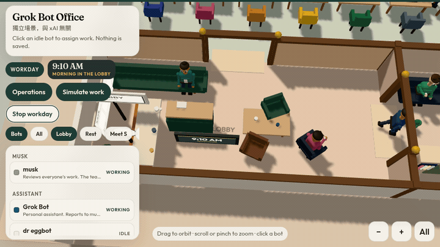

# Grok Bot 虛擬辦公室

一間可以在瀏覽器裡看的 3D 辦公室。每位 Grok Bot 隊友是一個小巧的人物，有自己的髮型、臉和衣服顏色，以及自己的桌子和休息區位子。全員向 **musk** 回報。

這是獨立作品，**不是 xAI 的官方產品，也與 xAI 沒有從屬或合作關係**。名稱只用來稱呼這支機器人團隊。



這段是 **Workday**（`?day=1`）：時鐘往前走，人在大廳和會議室之間移動，對話雲和思考雲會出現。點一個 **Idle** 的人，在頭頂雲朵裡打字，按 Enter 派工作。

## 怎麼跑

需要 Node.js 20 或更新版本。

```bash
git clone https://github.com/tonythetiger168/grok-hq.git
cd grok-hq
npm install
npm run dev
```

終端機會印出本機網址（預設 `http://127.0.0.1:4317`）。正式靜態檔：

```bash
npm run build
npm run preview
```

`dist/` 就是可以放到任何靜態主機的成品。`npm run preview` 會一併帶上開發用的狀態 API；純靜態主機沒有這個 API，狀態改走 `status.json`。

檢查名單與狀態格式：

```bash
npm run check
```

## 畫面上有什麼

- **musk** 坐在玻璃隔間的角落辦公室。地毯與玻璃上都寫著大家向 musk 回報。
- **Grok Bot** 是個人助理，桌子在 Assistant，不是主管。
- 一層樓的故事總部，房間靠在一起：入口是大廳（沙發、時鐘，角落有一杯迎接客人的咖啡）。大廳旁邊是兩間關起來的房間，一間是 Meeting 會議室（會議桌、站會），一間是 Coffee 咖啡室（咖啡吧、杯子、暖燈，地上寫著 COFFEE）。團隊坐同一間桌子廳。走廊岔出圖書館和點心吧，影印機在走廊附近。musk 的玻璃辦公室在這條路的盡頭，地上寫著 REPORTS TO MUSK。
- 開源研究的十位跟大家坐在同一間桌子廳。
- 預設每個人都是 **Idle**，坐在休息區。桌子是空的，名牌還在。沒有人在做「真的工作」。
- 滑過角色會出現名字。點一下（或點名冊）會把鏡頭拉近，並跟著那位角色。
- 兩個人說話時，中間會浮出對話雲；一個人自言自語也有。想事情是另一種思考雲：雲朵形，底下有一串小圓點連回頭上。
- 點一個 **Idle** 的人，在頭頂對話雲裡打工作內容，按 Enter。對方會離開休息去做事；若寫到 PR、CI 或 plan，之後向 musk 回報時會沿著這句話。
- 拖曳旋轉、滾輪或雙指縮放、右鍵平移。手機上有放大、縮小、回到全景。
- 上方的分區按鈕把鏡頭帶到該區。
- 大廳牆邊有一面「每週用量」板，只寫稍後再接，**沒有任何數字**。

## 一日工作

「Workday」按鈕，或網址 `?day=1`，用幾分鐘演完 9:00 AM 到 6:00 PM。畫面上的時鐘（大廳也有一面）帶著行程：先在大廳集合，有人走進 Coffee 咖啡室，站會在 Meeting，有人去影印，其他人在桌子、圖書館或點心吧想計畫。一次只有一個人把文件拿給 musk；musk 會想一下，再對那個人說 PR 要開著、關掉，或 CI 是綠的還是失敗，並派下一步。對方做完會再回來。`?at=10:30` 可以從那個時間開始。這只在這個分頁裡演，不會寫入 `status.json`。

## 模擬工作

「Simulate work」按鈕，或網址加上 `?simulate=1`、`?demo`、`#demo`，會在**這個分頁裡**演一段忙碌的一天：有人在自己的桌子打字，有人到會議室開站會，有人站在會議室門口揮手，有人頭頂紅色驚嘆號。做完的人會拿著文件走進 musk 的辦公室交件，轉一圈，再回到休息區。

畫面頂部會出現 **SIMULATION** 徽章，還有一條橘色細線。這段動畫**不會**寫入 `status.json`，也不會對 `/api/status` 送出資料。按「Stop simulation」之後，畫面回到伺服器或靜態檔上的狀態。

## 營運

「Operations」按鈕，或網址 `?ops=1`，把辦公室當成控制室。人的位置跟 `GET /api/status`（沒有 API 就用 `status.json`）的 `idle`、`working`、`waiting`、`error`、`done` 走：做事的人在桌子或站會，卡住的人停在桌邊，做完的人一次一個去找 musk。名冊裡有倉庫的人，開發伺服器會用 GitHub 讀最近的 PR 是開著、關掉還是已合併，以及 CI 是綠的、失敗還是還在跑。讀不到 GitHub 時，只用狀態裡寫明的 `pr`、`ci`、`plan`，畫面上會標 **status**，不會假裝那是即時數字。

桌子螢幕下方有一條顏色：綠、紅、黃。點人名可以看到 PR、CI，以及來源是 GitHub 還是 status。musk 的決定、對話雲、還有你在頭頂雲朵打的工作，都用同一組詞：計畫、PR、CI、下一步。打字派工只留在這個分頁，不會 POST。Workday 和 Simulate 也不會寫狀態。

```bash
curl -s -X POST http://127.0.0.1:4317/api/status \
  -H 'content-type: application/json' \
  -d '{"name":"quant","state":"done","task":"reporting the open PR","pr":"open","ci":"green","plan":"review"}'
```

`pr` 是 `open`、`closed`、`merged`、`none`。`ci` 是 `green`、`failed`、`pending`、`none`。POST 若省略這三欄，會留下上一次的值。

## 接上真正的狀態

程式先試 `GET /api/status`，失敗再讀 `/status.json`。格式：

```json
{
  "bots": [
    { "name": "quant", "state": "working", "task": "reading the repo", "plan": "review", "pr": "open", "ci": "green" }
  ]
}
```

`state` 只能是 `idle`、`working`、`waiting`、`error`、`done`。沒寫到的人維持 `idle`。`task` 最長 140 字。`plan`、`pr`、`ci` 可省略。名字要和名冊完全一致（大小寫不拘），例如 `Grok Bot`、`dr eggbot`、`helios forge`。

`public/status.json` 預設全員 `idle`。改這個檔再重新整理，靜態站就會顯示新狀態。

`npm run dev`（以及 `npm run preview`）另外提供記憶體版 API。它啟動時讀一次 `status.json`，之後的 POST 只活在該次行程裡，重新啟動就回到檔案內容，也**不會**把模擬寫進去。

```bash
curl -s http://127.0.0.1:4317/api/status

curl -s -X POST http://127.0.0.1:4317/api/status \
  -H 'content-type: application/json' \
  -d '{"name":"quant","state":"working","task":"reading the repo"}'
```

一次更新多人：`{"bots":[...]}`。全部回到休息：`{"reset":true}`。

機器人可以在開始時 POST `working` 和一行 task，需要人時 POST `waiting`，卡住時 POST `error`，做完時 POST `done`，回到休息時 POST `idle`。瀏覽器大約每 4 秒讀一次。正式環境請自己做一個同樣格式的 `GET/POST /api/status`，或只更新 `status.json` 再部署。

## 檔案

| 檔案 | 做什麼 |
| --- | --- |
| `index.html` | 頁面外殼 |
| `src/main.js` | 場景、燈光、鏡頭、點選、動畫迴圈 |
| `src/office.js` | 房間、桌子、交誼區、植物、伺服器、用量牆 |
| `src/bots.js` | 角色造型與動作 |
| `src/clouds.js` | 對話雲與思考雲 |
| `src/roster.js` | 名單、顏色、職務、倉庫名稱 |
| `src/layout.js` | 平面配置與鏡頭預設 |
| `src/status.js` | 輪詢狀態、營運、模擬、一日工作 |
| `src/status-model.js` | 狀態格式，瀏覽器與開發伺服器共用 |
| `src/ops-summary.js` | 把 PR / CI 收成辦公室用的詞 |
| `scripts/github-ops.mjs` | 開發伺服器讀 GitHub，瀏覽器不直接打 |
| `src/ui.js` | 名冊、徽章、模擬按鈕 |
| `src/style.css` | 介面樣式 |
| `src/geom.js` | 小幾何工具 |
| `src/paint.js` | 文字與貼圖 |
| `src/screens.js` | 螢幕著色 |
| `vite.config.js` | 開發伺服器與 `/api/status` 雛形 |
| `public/status.json` | 靜態狀態，預設全員 idle |
| `scripts/check.mjs` | 檢查名單與狀態合併 |

## English

An independent 3D office for the Grok Bot team. It is not an official xAI product and is not affiliated with xAI. **musk** is the leader every bot reports to; that line is on the glass office and the floor.

The clip at the top is **Workday** (`?day=1`): the clock runs, people move through the lobby and standup, and musk decides on an open PR. Click an idle bot and press Enter to assign work.

```bash
git clone https://github.com/tonythetiger168/grok-hq.git
cd grok-hq
npm install
npm run dev
```

Static build: `npm run build` then `npm run preview` (or host `dist/` yourself).

Everyone starts **Idle** in the lobby. Each bot is a small stylized person — hair, face, and clothes in their own color. The floor is one compact storybook HQ. The lobby is the entrance (sofas, clock, and a small greeting coffee nook). Beside it are two enclosed rooms: **Meeting** (the standup table) and **Coffee** (a café bar, cups, warm lamps, and a COFFEE sign). The team shares a desk hall. A corridor opens onto the library and a snack nook, with the copier nearby. **musk**'s glass corner office is at the end of that path; the floor there reads REPORTS TO MUSK. Grok Bot is a personal assistant at a desk in the hall, not a second boss. Chips frame Lobby, Meeting, Coffee, Desks, Library, Snacks, Copier, and musk.

Speech clouds sit between people who are talking, and a person talking to themselves gets one too. Thoughts use a scalloped cloud with small circles trailing back to the head. Click an idle bot and press Enter in the cloud by their head to assign work.

**Workday** (`?day=1`, optional `?at=10:30`) plays 9:00 AM–6:00 PM in a few minutes. The clock on screen and in the lobby drives the story: the lobby, coffee in the Coffee room, standup in Meeting, a copier, snack bars, and one report to musk at a time. musk answers about the plan, whether a PR is open or closed, and whether CI is green or failed, then the bot follows up. It never writes `status.json`.

**Simulate work** (`?simulate=1`, `?demo`, or `#demo`) plays a busy day in that browser tab only. Working bots sit at desks or gather for a standup. Waiting bots wave by a desk or at the meeting-room doorway. Finished bots carry a folder into musk's office, then return to the rest area. It never writes `status.json` and never POSTs to `/api/status`. A **SIMULATION** badge stays on screen.

**Operations** (`?ops=1`) is the live control room. Bot places follow `idle / working / waiting / error / done` from `GET /api/ops` (dev) or `status.json`. On the dev server, roster repos are read from GitHub: PR open, closed, or merged, and CI green, failed, or pending. A status field overrides GitHub. If GitHub cannot be read, only those fields are shown and they are labeled status — never as live numbers. Desk screens carry a green, red, or amber stripe. musk's decision, the speech clouds, and a typed assignment all use that same plan / PR / CI / follow-up. Click an idle bot and press Enter to assign; the assignment stays in the browser. Workday and Simulate do not write status.

Live status is `GET /api/status` on the dev server, or `public/status.json` anywhere static. Shape: `{ "bots": [{ "name", "state", "task", "plan?", "pr?", "ci?" }] }` with `state` of `idle | working | waiting | error | done`. `pr` is `open | closed | merged | none`. `ci` is `green | failed | pending | none`. Omitted bots stay idle. POST the same shape to the dev stub; omitted `plan`, `pr`, and `ci` keep their previous values. `{ "reset": true }` returns everyone to idle. The stub keeps the body in memory until the process restarts and does not accept the simulation or the workday. See the Chinese section for curl examples and the file map.

A board in the lobby is a weekly-usage placeholder. It has no numbers.
